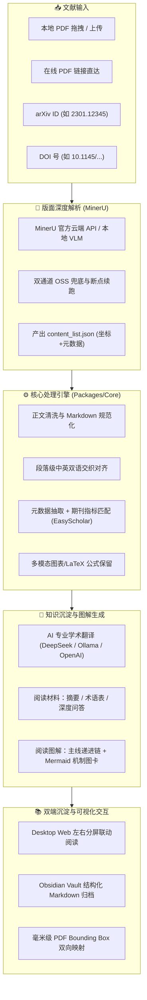

# PDF2Obsidian · 本地学术论文深度阅读与知识沉淀工作台

<p align="center">
  
  
  
  
  
  
  
  
</p>

<p align="center">
  <strong>基于 MinerU 深度版式解析与 LLM 的 Local-First（本地优先）全流程学术研读系统</strong><br>
  开箱即用 · PDF 与双语文档毫米级双向视口联动 · 论文逻辑主线阅读图解 · 虚拟视口极速渲染 · 工业级高可用与安全防御
</p>

<p align="center">
  <a href="#-核心特性一览">核心特性</a> •
  <a href="#-双端生态支持">双端生态</a> •
  <a href="#-系统工作流架构">工作流程</a> •
  <a href="#-快速上手">快速上手</a> •
  <a href="#-配置指南">配置指南</a> •
  <a href="#-文件资产组织">文件组织</a> •
  <a href="#-开发与贡献">参与贡献</a>
</p>

---

## 📖 项目背景与设计哲学

传统学术论文阅读存在几大痛点：
- **格式碎片化**：复制 PDF 文本破坏排版，公式乱码、表格断裂、跨页截断；
- **对照割裂**：翻译软件无法定位原文位置，缺乏段落级对照与原图版式支撑；
- **心智负担重**：长达数十页的复杂论文缺乏主线脉络，孤立阅读难以快速理清机制与递进逻辑；
- **隐私与锁定**：云端服务存在数据泄露风险，且高度依赖中心化平台。

**PDF2Obsidian** 为解决这些问题而生：
- 🔒 **Local-First（本地优先）**：所有解析产物、缓存与 Markdown 笔记均存储在本地，纯离线 PDF 渲染引擎，数据完全归您所有；
- 🔬 **高精度版面深度解析**：依托 [MinerU](https://github.com/opendatalab/MinerU) 提取高精度 Markdown、LaTeX 公式、结构化表格及各区块在 PDF 中的精确物理坐标；
- 🎯 **双向毫米级视口联动**：点击 PDF 识别框直达正文，点击段落标签精准定位 PDF 对应页与位置；
- 📊 **论文全景阅读图解**：顺着论文逻辑主线出图，提炼主旨脉络、环节衔接、Mermaid 机制流程图与原文出处；
- 🖥️ **双端无缝生态**：既提供开箱即用、无需安装任何第三方软件的 **Desktop Web 工作台**，也提供直接嵌入个人知识库的 **Obsidian 原生插件**。

---

## ✨ 核心特性一览

### 1. 🎯 毫米级 PDF 与正文双向深度联动 (Bidirectional Block Linking)
- **视觉版式还原**：基于 MinerU `content_list.json` 页码与标准化 Bounding Box 坐标，在原版 PDF 页面精确绘制识别框（正文、标题、图表、公式、脚注等）。
- **正向精准联动**：在左侧 PDF 视口中点击任意蓝色识别框，右侧文档即刻平滑滚动并高亮锁定对应段落或中英对照条目。
- **反向同步定位**：在右侧 Markdown 或中英双语对照中点击任意段落（或“第 N 页 ↗”标签），左侧 PDF 自动跳转至对应页码并聚焦对应位置。
- **专业级阅读控制**：支持自适应宽度、缩放、手势平移（拖拽画布）、一键切换识别框显隐以及快速跳页。
- **纯本地 PDF 引擎**：集成 `pdfjs-dist` 并预置本地 Web Worker，**完全不依赖外部 CDN**，断网环境极致流畅。

### 2. 📊 论文全景逻辑阅读图解 (Reading Visuals & Mechanism Mapping)
- **主线推进链**：自动分析论文体裁（如综述/实证/算法）与核心主旨，提炼 2–5 个核心递进环节形成直观逻辑链。
- **结构化图解卡片**：
  - **环节衔接**：交代承接上一环节的问题与上下文背景；
  - **核心要点**：提炼本环节必懂结论，过滤冗余技术噪音；
  - **机制图表**：自动生成高保真 Mermaid 流程图、机制图或多维数据表格；
  - **深入拆解**：针对机制边界与关键口径逐条细化；
  - **精准溯源**：标注具体出处章节，支持随时与原文交叉核验。
- **高容错与重试保护**：内置长连接请求重试与错误自愈机制，即使面对复杂图解的长耗时生成也能稳定交付。

### 3. 🌐 高保真中英双语对照系统 (Bilingual Markdown & Auto Pairing)
- **段落级并列交织**：在同一章节标题下先英文原文、后中文译文，标题中英并列呈现（如 `# Method　方法`），大幅降低阅读疲劳感。
- **多模态单份保真**：代码块、独立 LaTeX 公式（`$$`）、提取图片（``）等无需翻译的内容智能保留单份，不拆分内部空行，杜绝误识别。
- **断点结构容错**：面对大模型偶然的段落合并或拆分，采用章节级安全回退兜底，确保后续小节继续严密对齐。
- **零成本平滑沉淀**：自动生成 `*.bilingual.md`。针对历史已有任务，首次打开对照视图直接就地秒级生成，**无需重复调用 AI 接口**。

### 4. ⚡ 虚拟化渲染与流式响应 (Virtualized Viewport)
- **按需延迟挂载 (Deferred Block)**：基于 `IntersectionObserver` 仅渲染可视区域附近的段落与公式。
- **杜绝掉帧卡顿**：从 PDF 点击远端段落时在单次 commit 中直接挂载并滚动，数十页大论文、数百个复杂 KaTeX 公式无缝流畅。
- **智能指纹防抖**：采用 `taskFingerprint` 状态比对，轮询任务状态时未变更内容绝不触发二次重渲染。

### 5. 🏛️ 多维学术元数据与期刊评级 (Metadata & Metrics)
- **学术元数据清洗**：自动规范化论文标题、完整作者列表（不切断带有连字符与逗号的姓名）、DOI、发表刊物与收录年份。
- **在线权威校验**：可选集成 CrossRef 与 OpenAlex 开放学术数据库，自动补全引用指标。
- **权威期刊分区**：集成 EasyScholar 与本地 SQLite 分区库，一目了然显示中科院分区、JCR 分区、CCF 推荐评级与影响因子（IF）。

### 6. 🛡️ 工业级弹性容错与企业安全防御 (Security & Resilience)
- **全方位 SSRF 防御屏障**：严格拦截私有网段（`10.0.0.0/8`, `172.16.0.0/12`, `192.168.0.0/16`）、本地环回（`127.0.0.1`, `localhost`）、云元数据接口及非法协议。
- **敏感凭据脱敏**：API Key 与 Token 在前端请求、界面渲染及 YAML 导出时自动掩码（`••••••••`），杜绝意外泄露。
- **任务断点自愈**：解析状态自动持久化至 `official-task.json`，失败重试复用已有任务；POST 提交防重复重放，避免多余计费。
- **双通道下载兜底**：MinerU 官方 CDN 下载遇波动时，自动降级至官方 OSS 节点备用通道。
- **安全沙箱机制**：基于 `rehype-sanitize` 严格过滤 XSS 攻击；下载设有 200MB 熔断限流，防范内存耗尽。

---

## 🖥️ 双端生态支持

PDF2Obsidian 同时提供两种使用方式，任选其一或协同使用：

| 特性维度 | Desktop Web 工作台 (无需安装 Obsidian) | Obsidian 官方插件 (嵌入个人笔记库) |
| :--- | :--- | :--- |
| **适用场景** | 快速研读、临时阅读、文献导入初筛、独立桌面环境 | 个人知识库深度管理、双链沉淀、长期复习积累 |
| **技术底座** | Next.js 15 + React 19 + Tailwind CSS | Obsidian Plugin API + React 19 + esbuild |
| **PDF 联动** | 左右自由调节弹性分屏，毫米级双向视口滚动 | 独立 Leaf/Tab 原生分屏，无缝融入 Obsidian 窗口体系 |
| **图解渲染** | 响应式图卡流 + Mermaid 实时交互预览 | Obsidian 风格主题自适应 + 图表点击放大 |
| **使用门槛** | 浏览器打开即用（免配库目录） | 复制到 `.obsidian/plugins/` 启用即用 |

---

## 🔄 系统工作流架构



---

## 🚀 快速上手

### 环境准备
- **Node.js**: `>= 20.0.0`
- **包管理器**: `pnpm >= 10.0.0` (推荐) 或 `npm`

### 1. 克隆仓库并安装依赖
```bash
git clone https://github.com/ber-ners/PDF2Obsidian.git
cd PDF2Obsidian
pnpm install --frozen-lockfile
```

### 2. 方式 A：启动 Desktop Web 工作台 (开箱即用)
```bash
npm run dev
```
打开浏览器访问 **[http://127.0.0.1:3001](http://127.0.0.1:3001)**。首次启动会自动生成 `pdf2obsidian.config.yaml` 基础配置文件。

### 3. 方式 B：构建并使用 Obsidian 插件
```bash
npm run build:plugin
```
编译产物位于 `apps/obsidian-plugin/`（包含 `main.js`, `manifest.json`, `styles.css`）：
1. 在你的 Obsidian 仓库中创建目录：`<Vault>/.obsidian/plugins/pdf2obsidian/`；
2. 将上述三个文件复制至该目录；
3. 打开 Obsidian 设置 -> 第三方插件 -> 启用 **PDF2obsidian**。

---

## ⚙️ 配置指南 (`pdf2obsidian.config.yaml`)

你可以直接通过 Web 端界面的 **设置 (Settings)** 页面可视化配置，也可以直接编辑根目录的配置文件：

```yaml
# 本地处理结果输出目录
output:
  path: /Users/yourname/PDF2obsidian/output

# MinerU 解析服务设置
mineru:
  mode: official                 # 解析模式: "official"（云端 API，免本地显卡）| "local"（本地服务）
  backend: pipeline              # 解析后端: "pipeline" | "vlm-http-client"
  apiToken: sk-xxxxxxxxxxxx      # MinerU 官方 API Token（或设置环境变量 MINERU_OFFICIAL_API_TOKEN）
  apiUrl: http://127.0.0.1:30000 # local 模式下的本地服务地址
  formula: true                  # 启用数学公式识别
  table: true                    # 启用复杂表格还原
  imageAnalysis: true            # 启用多模态图片识别
  requestTimeoutMs: 30000        # 单次网络请求超时（毫秒）
  taskTimeoutMs: 1800000         # 任务最长轮询超时（30分钟）
  maxRetries: 2                  # 临时网络故障重试次数

# AI 翻译与图解服务
translation:
  enabled: true                  # 设为 false 则仅解析排版，不消耗 AI Token
  provider: openai-compatible    # "openai-compatible" | "ollama"
  preset: deepseek               # 预设模型服务
  model: deepseek-chat           # 推荐 deepseek-chat 或 deepseek-reasoner
  baseUrl: https://api.deepseek.com
  apiKey: sk-xxxxxxxxxxxx        # API Key（或配置 apiKeyEnv: DEEPSEEK_API_KEY）
  chunkCharLimit: 24000          # 单次翻译分块字符上限
  maxRetries: 3                  # 请求重试次数

# AI 阅读辅助与图解材料
readingAssets:
  enabled: true                  # 启用摘要、术语表、问答与阅读图解
  summaryFileName: 摘要.md
  termsFileName: 术语表.md
  qaFileName: 问答.md
  workflowFileName: 流程图.md      # 阅读图解输出文件名
  maxSourceChars: 50000          # 提炼上下文最大字数上限

# 学术元数据清洗与期刊评级
metadata:
  enrichFromMarkdown: true       # 从全文自动清洗标题、作者
  online:
    enabled: true                # 是否通过 CrossRef / OpenAlex 补全元数据
    providers:
      - crossref
      - openalex
  journalMetrics:
    easyScholar:
      enabled: false             # 可选启用 EasyScholar 查询中科院/JCR分区
      secretKeyEnv: EASYSCHOLAR_SECRET_KEY
```

> [!TIP]
> **只想解析论文，不想配置大模型？**
> 将 `translation.enabled` 与 `readingAssets.enabled` 设为 `false`（或在 Web 界面勾选“仅解析论文”），即可完全跳过 AI 接口，0 配置直接享受高精度的 MinerU 解析与 PDF 双向联动阅读！

---

## 📂 文件资产组织

PDF2Obsidian 处理完一篇论文后，会生成规范自洽的知识资产目录，可无缝作为 Obsidian 笔记库或直接阅读：

```text
output/papers/<论文唯一标识>/
├── <论文名>.md                # 规范化原文 Markdown（包含 KaTeX 公式与规范层级）
├── <论文名>.zh.md             # 独立中文译文
├── <论文名>.bilingual.md      # 精细化中英段落并列对照正文
├── 流程图.md                  # 🌟 论文全景阅读图解（逻辑主线、递进图卡、Mermaid 机制图）
├── 摘要.md                    # 结构化核心摘要与研究贡献
├── 术语表.md                  # 核心专业术语双语对照表
├── 问答.md                    # 针对论文核心论点的深度 Q&A
├── index.md                  # 论文元数据看板、作者信息、期刊分区与双链索引
├── <论文名>.pdf               # 原始 PDF 文件本地备份
└── images/                   # 提取的高清学术插图与表格渲染图
```

---

## 🧩 Monorepo 工程架构

```text
PDF2obsidian/
├── apps/
│   ├── desktop-web/       # Next.js 15 桌面 Web 工作台（双向视口、虚拟渲染、图卡面板）
│   ├── obsidian-plugin/   # Obsidian 官方插件源码（原生视图挂载、React 19 渲染）
│   └── cli/               # 命令行工具（批量导入、目录监控）
├── packages/
│   ├── core/              # 核心业务：Markdown 规范化、双语交织对齐、图解解析器
│   ├── pipeline/          # 文献导入流水线、DOI / arXiv 下载解析与安全防线
│   ├── providers/         # 大模型抽象适配层（OpenAI-Compatible、Ollama）
│   └── tasks/             # 本地任务持久化、状态机与并发队列调度
├── scripts/               # 跨平台构建、Web Worker 自动部署与 Workspace 脚本
└── tests/                 # 工业级自动化测试集（覆盖安全、解析、对齐、图解与重试）
```

---

## 🛠️ 常用开发脚本

| 命令 | 说明 |
| :--- | :--- |
| `npm run dev` | 启动本地 Web 开发工作台（监听 `127.0.0.1:3001`） |
| `npm run build` | 编译构建生产环境 Web 工作台与所有 monorepo 基础包 |
| `npm start` | 以生产模式运行 Web 工作台 |
| `npm run build:plugin` | 编译构建 Obsidian 插件生产产物 |
| `npm run dev:plugin` | 监听模式调试 Obsidian 插件 |
| `npm test` | 执行全量单元测试与集成测试（**78 项测试全量通过**） |
| `npm run test:mineru` | 专项验证 MinerU 网络超时、退避重试、断点自愈与 OSS 降级 |
| `npm run dev:cli -- import <file>` | CLI 命令行模式单篇导入 |

---

## 🛣️ 路线图 (Roadmap)

- [x] 基于 MinerU 的段落、公式、表格级坐标高精度提取
- [x] PDF 页面识别框与 Markdown / 双语视口毫米级双向联动
- [x] 段落级中英双语交织对齐与容错机制
- [x] 长篇论文虚拟视口按需渲染（彻底解决海量数学公式卡顿）
- [x] 论文主线递进链与全景阅读图解（Mermaid 机制可视化）
- [x] 工业级网络弹性（长连接超时重试、官方 Batch 断点复用、双通道兜底）
- [x] 企业级安全防护（SSRF 严格阻断、DNS 重新绑定防御、Token 掩码脱敏）
- [x] Desktop Web 与 Obsidian 官方插件双端支持
- [ ] 知识图谱跨文献关联与标签引文网络自动构建
- [ ] 增强型多模态对比（论文原图与正文上下文悬浮浮窗）
- [ ] 本地向量索引与跨文献智能检索问答（Local RAG）

---

## 🤝 参与贡献

热烈欢迎提交 Issue 与 Pull Request！

1. Fork 本仓库并创建特性分支 (`git checkout -b feature/AmazingFeature`)；
2. 运行并确保通过全量测试：`npm test`；
3. 提交代码更改 (`git commit -m 'feat: add some amazing feature'`)；
4. 推送至分支 (`git push origin feature/AmazingFeature`)；
5. 新建 Pull Request。

---

## 📄 开源许可证与致谢

本项目采用 **[MIT License](LICENSE)** 协议开源。

特别致谢以下优秀的开源项目与学术基础设施：
- [MinerU](https://github.com/opendatalab/MinerU)：卓越的多模态学术文献提取与版面分析工具；
- [PDF.js](https://mozilla.github.io/pdf.js/)：可靠的 HTML5 PDF 渲染引擎；
- [KaTeX](https://katex.org/)：高性能学术数学公式排版引擎；
- [Mermaid](https://mermaid.js.org/)：轻量而强大的图表与流程图可视化方案；
- [EasyScholar](https://www.easyscholar.cc/)：便捷权威的学术期刊等级评价数据源；
- [Obsidian](https://obsidian.md/)：深受学者与研究者喜爱的本地知识管理平台。

---

<p align="center">
  如果这个项目对你的文献研读与知识管理有所帮助，欢迎在 GitHub 上点亮一颗 ⭐️ <strong>Star</strong>！
</p>
